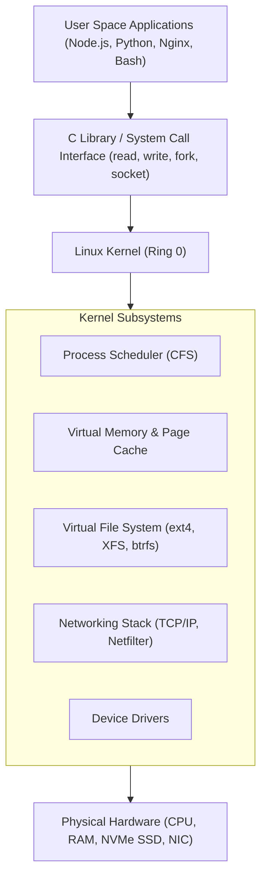
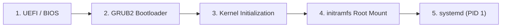
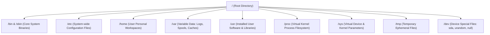
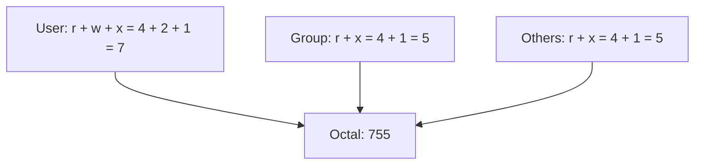
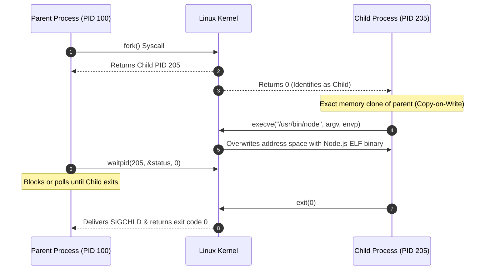
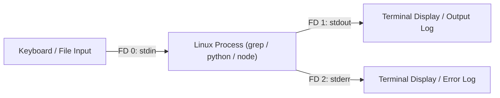
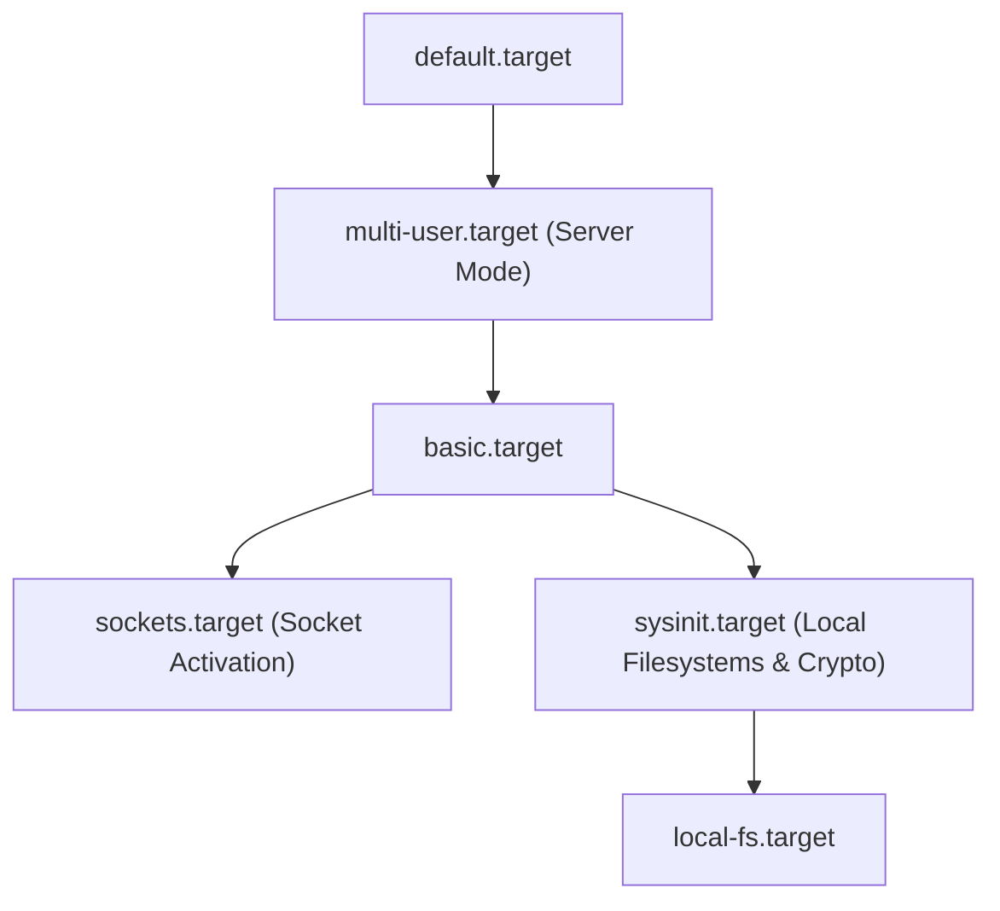
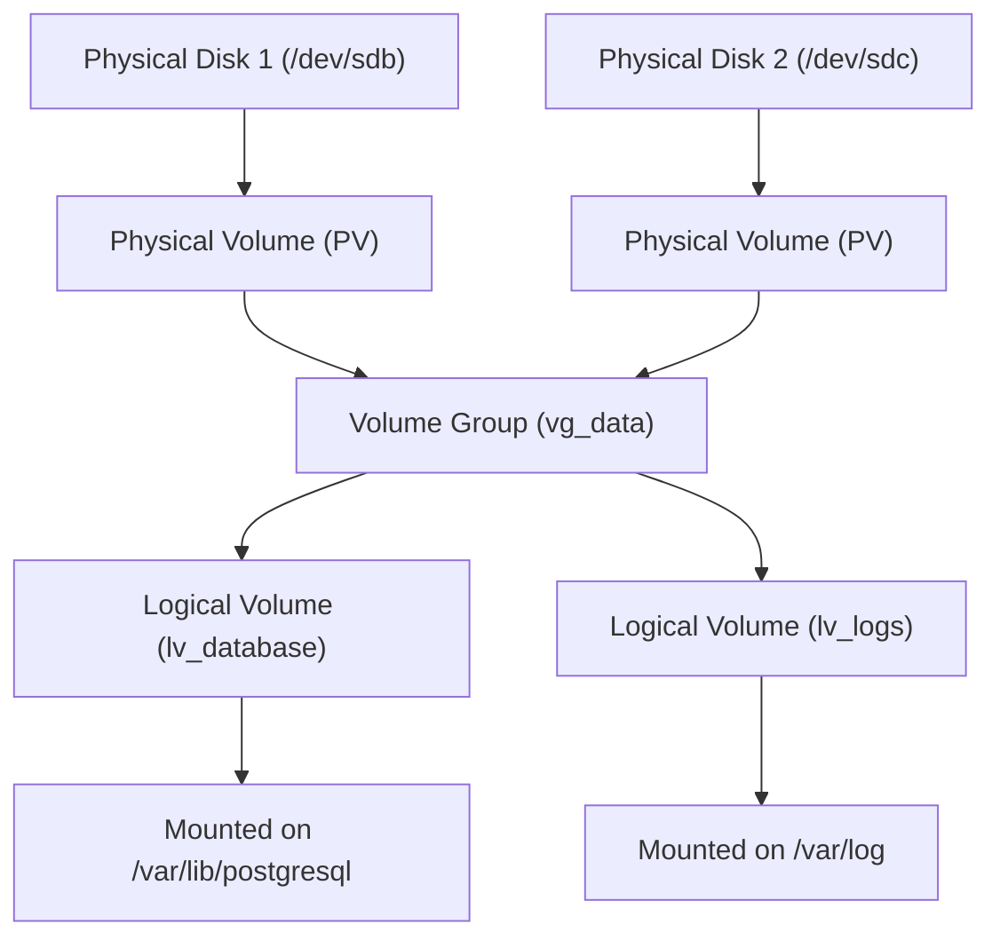
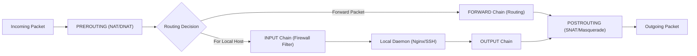

# Learn Linux 🐧

<div align="center">

[](https://opensource.org/licenses/MIT)
[](https://standards.ieee.org/)
[](https://vitest.dev/)
[](https://github.com/manthanank/learn-linux)

**An exhaustive, production-grade masterclass from absolute zero to staff-level Linux systems administration & Site Reliability Engineering (SRE).**  
Master the Linux Filesystem Hierarchy Standard (FHS), POSIX permissions, kernel processes and signals, stream redirection pipelines, systemd service units, networking and firewall configuration, LVM storage management, cgroups/namespaces, and kernel internals.

[Getting Started](#1-stage-1-absolute-beginner-foundations--filesystem-hierarchy) • [Permissions](#2-stage-2-posix-permissions-ownership--user-management) • [Processes & Signals](#3-stage-3-process-management-kernel-signals--job-control) • [Pipes & Redirection](#4-stage-4-streams-redirection-pipes--text-processing) • [systemd & Daemons](#5-stage-5-systemd-service-architecture-daemons--automation) • [Networking & SSH](#6-stage-6-enterprise-networking-firewalls--ssh-hardening) • [Interview Handbook](#7-stage-7-staff-linux-systems-engineer--sre-interview-handbook)

<br/>

<a href="https://www.buymeacoffee.com/manthanank">
  
</a>

</div>

---

## 🗺️ 7-Stage Pedagogical Roadmap


| Stage | Focus Domain | Core Concepts & Engineering Outcomes |
| :--- | :--- | :--- |
| **Stage 1** | **Absolute Beginner Foundations** | Boot sequence (UEFI -> GRUB -> Kernel -> systemd), Filesystem Hierarchy Standard (`/`, `/etc`, `/var`, `/proc`), path resolution, core navigation. |
| **Stage 2** | **POSIX Permissions & Users** | Octal notation (`755`, `644`), SUID/SGID/Sticky Bit, `sudoers`, `/etc/passwd`, `/etc/shadow`, group ACLs. |
| **Stage 3** | **Processes, Signals & Job Control** | PID/PPID, `fork`/`exec` syscalls, kernel signals (`SIGTERM`, `SIGKILL`, `SIGHUP`), `ps`, `top`, `strace`, background jobs. |
| **Stage 4** | **Streams, Redirection & Pipelines** | File descriptors (`0`, `1`, `2`), pipeline streaming (`|`), `grep`, `sed`, `awk`, `find`, `xargs`, production Bash scripting. |
| **Stage 5** | **systemd Daemons & Automation** | Service unit architecture (`[Unit]`, `[Service]`, `[Install]`), `journalctl`, timers, cron scheduling, LVM storage management. |
| **Stage 6** | **Networking, Firewalls & Security** | Socket inspection (`ss`, `ip`), iptables/nftables packet filtering, SSH key hardening, Fail2ban, SELinux, eBPF overview. |
| **Stage 7** | **Staff SRE & Systems Interview Handbook** | Virtual memory, page cache, inode exhaustion, OOM killer mechanics, 25 in-depth staff interview Q&As, CLI cheat sheet. |

---

## 📋 Comprehensive Table of Contents

1. [Stage 1: Absolute Beginner Foundations & Filesystem Hierarchy](#1-stage-1-absolute-beginner-foundations--filesystem-hierarchy)
   - 1.1 [What is the Linux Kernel vs Operating System?](#11-what-is-the-linux-kernel-vs-operating-system)
   - 1.2 [The Linux Boot Sequence Architecture](#12-the-linux-boot-sequence-architecture)
   - 1.3 [The Filesystem Hierarchy Standard (FHS)](#13-the-filesystem-hierarchy-standard-fhs)
   - 1.4 [Essential Navigation & File Operations](#14-essential-navigation--file-operations)
   - 1.5 [Line-by-Line Command Breakdown: Core Operations](#15-line-by-line-command-breakdown-core-operations)
2. [Stage 2: POSIX Permissions, Ownership & User Management](#2-stage-2-posix-permissions-ownership--user-management)
   - 2.1 [Understanding the POSIX Permission Triad](#21-understanding-the-posix-permission-triad)
   - 2.2 [Octal Calculation Matrix (4-2-1 Rule)](#22-octal-calculation-matrix-4-2-1-rule)
   - 2.3 [Special Permissions: SUID, SGID & The Sticky Bit](#23-special-permissions-suid-sgid--the-sticky-bit)
   - 2.4 [Line-by-Line Breakdown: Permission Hardening](#24-line-by-line-breakdown-permission-hardening)
   - 2.5 [User and Group Administration (/etc/passwd, /etc/shadow)](#25-user-and-group-administration)
3. [Stage 3: Process Management, Kernel Signals & Job Control](#3-stage-3-process-management-kernel-signals--job-control)
   - 3.1 [The Process Lifecycle: fork(), exec(), and wait()](#31-the-process-lifecycle-fork-exec-and-wait)
   - 3.2 [Kernel Signals: SIGTERM (15) vs SIGKILL (9) vs SIGHUP (1)](#32-kernel-signals-sigterm-15-vs-sigkill-9-vs-sighup-1)
   - 3.3 [Process Inspection & Resource Profiling (ps, top, htop, lsof)](#33-process-inspection--resource-profiling)
   - 3.4 [System Call Tracing with strace](#34-system-call-tracing-with-strace)
   - 3.5 [Job Control: Foreground, Background (&), nohup, and disown](#35-job-control-foreground-background--nohup-and-disown)
4. [Stage 4: Streams, Redirection, Pipes & Text Processing](#4-stage-4-streams-redirection-pipes--text-processing)
   - 4.1 [The Three Standard Streams: stdin (0), stdout (1), stderr (2)](#41-the-three-standard-streams-stdin-0-stdout-1-stderr-2)
   - 4.2 [I/O Redirection Syntax: >, >>, 2>&1, <, and Here-Docs](#42-io-redirection-syntax)
   - 4.3 [Text Processing Pipelines: grep, sed, awk, cut, and sort](#43-text-processing-pipelines-grep-sed-awk-cut-and-sort)
   - 4.4 [Line-by-Line Breakdown: Enterprise Log Parsing Pipeline](#44-line-by-line-breakdown-enterprise-log-parsing-pipeline)
   - 4.5 [Production Bash Scripting: Error Traps & Safe Defaults](#45-production-bash-scripting-error-traps--safe-defaults)
5. [Stage 5: systemd Service Architecture, Daemons & Automation](#5-stage-5-systemd-service-architecture-daemons--automation)
   - 5.1 [Understanding systemd PID 1 & Target Dependencies](#51-understanding-systemd-pid-1--target-dependencies)
   - 5.2 [Writing a Production systemd Service Unit](#52-writing-a-production-systemd-service-unit)
   - 5.3 [Line-by-Line Breakdown: Production systemd Unit](#53-line-by-line-breakdown-production-systemd-unit)
   - 5.4 [Structured Logging with journalctl](#54-structured-logging-with-journalctl)
   - 5.5 [Automated Scheduling: Cron & systemd Timers](#55-automated-scheduling-cron--systemd-timers)
   - 5.6 [Enterprise Storage: LVM (Logical Volume Manager) Deep Dive](#56-enterprise-storage-lvm-logical-volume-manager-deep-dive)
6. [Stage 6: Enterprise Networking, Firewalls & SSH Hardening](#6-stage-6-enterprise-networking-firewalls--ssh-hardening)
   - 6.1 [Network Configuration & Socket Inspection (ip, ss, dig)](#61-network-configuration--socket-inspection)
   - 6.2 [Packet Filtering with iptables & nftables](#62-packet-filtering-with-iptables--nftables)
   - 6.3 [SSH Key Architecture & Server Hardening (/etc/ssh/sshd_config)](#63-ssh-key-architecture--server-hardening)
   - 6.4 [Line-by-Line Breakdown: Hardened sshd_config](#64-line-by-line-breakdown-hardened-sshd_config)
   - 6.5 [Kernel Parameter Tuning with sysctl](#65-kernel-parameter-tuning-with-sysctl)
   - 6.6 [Mandatory Access Control & eBPF Observability](#66-mandatory-access-control--ebpf-observability)
7. [Stage 7: Staff Linux Systems Engineer & SRE Interview Handbook](#7-stage-7-staff-linux-systems-engineer--sre-interview-handbook)
   - 7.1 [Virtual Memory, Page Cache & The Linux OOM Killer](#71-virtual-memory-page-cache--the-linux-oom-killer)
   - 7.2 [Troubleshooting Inode Exhaustion & Disk Pressure](#72-troubleshooting-inode-exhaustion--disk-pressure)
   - 7.3 [Container Primitives: Namespaces & cgroups v2](#73-container-primitives-namespaces--cgroups-v2)
   - 7.4 [25 Staff-Level Systems & SRE Interview Q&As](#74-25-staff-level-systems--sre-interview-qas)
   - 7.5 [The Ultimate Linux Sysadmin CLI Cheat Sheet](#75-the-ultimate-linux-sysadmin-cli-cheat-sheet)


---

## 1. Stage 1: Absolute Beginner Foundations & Filesystem Hierarchy

### 1.1 What is the Linux Kernel vs Operating System?
**Linux** is not a complete operating system; it is a monolithic, multi-tasking Unix-like **kernel** originally created by Linus Torvalds in 1991.
- **The Kernel**: Interacts directly with physical hardware (CPU, RAM, storage controllers, network cards). It schedules CPU execution, allocates virtual memory, handles hardware interrupts, and provides a unified interface via **system calls (syscalls)**.
- **User Space**: Applications, system libraries (glibc), background daemons, and shells (Bash, Zsh) execute in an unprivileged hardware ring (Ring 3 on x86_64 architecture). Whenever a user space program needs to read from disk or send network packets, it executes a CPU software interrupt, transitioning into Kernel Space (Ring 0).



---

### 1.2 The Linux Boot Sequence Architecture
When power is applied to physical hardware or a virtual machine boots, Linux follows a deterministic 5-stage initialization pipeline:



| Phase | Component | Responsibilities & Mechanism |
| :--- | :--- | :--- |
| **1. Firmware** | **UEFI / BIOS** | Executes Power-On Self Test (POST). Initializes memory controllers, CPU registers, and loads NVMe/SATA boot disk. Reads the EFI System Partition (ESP). |
| **2. Bootloader** | **GRUB 2** | Presents the OS boot menu (`/boot/grub2/grub.cfg`). Loads the compressed Linux kernel image (`vmlinuz`) and the initial RAM disk (`initramfs`) into memory. |
| **3. Kernel Init** | **vmlinuz** | Decompresses itself in place. Configures memory paging, establishes hardware interrupts, and mounts the temporary root filesystem (`initramfs`). |
| **4. Early Userspace**| **initramfs** | Loads critical storage drivers (SCSI, RAID, NVMe, LVM, multipath). Locates and mounts the true physical root filesystem (`/`) read-only, then pivots (`pivot_root`). |
| **5. Init Process** | **systemd (PID 1)** | First userspace process with Process ID 1. Parses `/etc/systemd/system`, mounts virtual filesystems (`/proc`, `/sys`), spawns background daemons, and reaches `default.target`. |

---

### 1.3 The Filesystem Hierarchy Standard (FHS)
Unlike Windows, which organizes storage into volume letters (`C:`, `D:`), Linux presents a single unified hierarchical directory tree starting at the root directory (`/`).



| Directory | Full Classification | Operational Purpose & Real-World Use |
| :--- | :--- | :--- |
| `/` | **Root** | Top of the directory tree. All filesystems, physical drives, and network shares mount beneath `/`. |
| `/etc` | **Editable Text Configuration** | Stores static system-wide configuration files (e.g. `/etc/nginx/nginx.conf`, `/etc/passwd`, `/etc/fstab`). |
| `/var` | **Variable Data** | Files that change size dynamically during runtime: log files (`/var/log`), database data (`/var/lib/postgresql`), and print queues. |
| `/home` | **User Workspaces** | Contains personal files and private user configurations for human accounts (e.g. `/home/alex/.bashrc`). |
| `/root` | **Root User Home** | The dedicated home directory for the superuser `root` (kept separate from `/home` in case `/home` is on an unmounted partition). |
| `/proc` | **Virtual Process FS** | Pseudo-filesystem generated dynamically in memory by the kernel. Exposes runtime kernel data and process state (`/proc/cpuinfo`, `/proc/meminfo`, `/proc/[PID]`). |
| `/sys` | **Virtual System FS** | Exposes kernel objects, driver parameters, and device properties to user space. |
| `/dev` | **Device Nodes** | Represents hardware components as files: `/dev/sda` (disk), `/dev/urandom` (cryptographic random stream), `/dev/null` (data black hole). |
| `/usr` | **User System Resources** | Stores read-only user programs and libraries (`/usr/bin`, `/usr/lib`, `/usr/share`). |
| `/tmp` | **Temporary Storage** | Directory for ephemeral files. Frequently mounted in RAM (`tmpfs`) and purged on reboot. |

---

### 1.4 Essential Navigation & File Operations
The fundamental command set required to inspect, navigate, and manipulate the filesystem:

```bash
# 1. Print current working directory
pwd

# 2. List directory contents with permissions, owner, size, and human-readable formatting
ls -laht /var/log

# 3. Create nested directory trees in one atomic command
mkdir -p /opt/enterprise/backend/config

# 4. Copy directories recursively while preserving timestamps, ownership, and permissions
cp -av /opt/enterprise/backend /opt/enterprise/backend-backup

# 5. Atomic move or rename
mv /opt/enterprise/backend/config/old.json /opt/enterprise/backend/config/app.json

# 6. Safely remove files and directory trees
rm -ri /opt/enterprise/scratch

# 7. Create an empty file or update timestamp
touch /opt/enterprise/backend/.env

# 8. Create soft (symbolic) and hard links
ln -s /opt/enterprise/backend/config/app.json /etc/app-config.json
```

---

### 1.5 Line-by-Line Command Breakdown: Core Operations

| Command / Flag | Functionality | Technical Runtime Behavior |
| :--- | :--- | :--- |
| `ls -laht` | **Directory Inspection** | `-l` formats as long list; `-a` displays hidden dotfiles (`.bashrc`); `-h` outputs human-readable sizes (`14M`, `2.4G`); `-t` sorts by modification time descending. |
| `mkdir -p <dir>` | **Recursive Directory Creation** | `-p` (`--parents`) creates any missing intermediate parent directories automatically without returning an error if the directory already exists. |
| `cp -av <src> <dest>` | **Archive Copy** | `-a` (`--archive`) preserves all attributes: symbolic links, file permissions, user/group ownership, and modification timestamps; `-v` outputs verbose logging. |
| `rm -ri <path>` | **Interactive Recursive Removal** | `-r` traverses child subdirectories recursively; `-i` prompts for confirmation before deleting each file, preventing accidental disaster. |
| `ln -s <target> <link>` | **Symbolic Link (Symlink)** | Creates an inode referencing the path of the target file. If the original file is deleted, the symlink becomes a broken dangling reference. |


---

## 2. Stage 2: POSIX Permissions, Ownership & User Management

### 2.1 Understanding the POSIX Permission Triad
Every file and directory in Linux has an associated **Owner (User)**, an assigned **Group**, and a permission mask for **Others (World)**.
When executing `ls -l`, permissions display as a 10-character string:

```text
-rwxr-xr--  1 alex engineering 4096 Sep  6 06:30 deploy.sh
│├─┤├─┤├─┤
│ │  │  └─ Others: Read-only (r--)
│ │  └──── Group: Read and Execute (r-x)
│ └─────── User (Owner): Read, Write, and Execute (rwx)
└───────── File Type: Regular file (-) [d = directory, l = symlink]
```

---

### 2.2 Octal Calculation Matrix (4-2-1 Rule)
POSIX permissions are represented mathematically using 3-bit binary numbers:
- **Read (`r`)**: Weight = **4** (Binary `100`)
- **Write (`w`)**: Weight = **2** (Binary `010`)
- **Execute (`x`)**: Weight = **1** (Binary `001`)



| Octal Value | Binary Bits | Symbol | Meaning on a Regular File | Meaning on a Directory |
| :---: | :---: | :---: | :--- | :--- |
| **0** | `000` | `---` | No access whatsoever. | Cannot inspect or enter directory. |
| **4** | `100` | `r--` | Can read and view file content. | Can list directory contents (`ls`). |
| **5** | `101` | `r-x` | Can read and execute program/script. | Can list and enter directory (`cd`). |
| **6** | `110` | `rw-` | Can read and modify file content. | Can list and create/delete files in directory. |
| **7** | `111` | `rwx` | Full access (read, write, execute). | Full control to enter, list, create, and delete files. |

---

### 2.3 Special Permissions: SUID, SGID & The Sticky Bit
Beyond standard `rwx`, Linux enforces three advanced permission bits:

1. **SetUID (SUID - Bit 4000)**: When executed, binary runs with permissions of the file owner (e.g. `/usr/bin/passwd` runs as `root` to edit `/etc/shadow`).
2. **SetGID (SGID - Bit 2000)**: On executable, runs with group permissions. On a directory, files created inside inherit the parent directory's group automatically.
3. **Sticky Bit (Bit 1000)**: On a directory (e.g. `/tmp`), users can only delete or rename files they personally own, preventing tampering.

```bash
# 1. Apply standard secure permissions to a script
chmod 750 /opt/scripts/deploy.sh

# 2. Change owner and group recursively
chown -R alex:engineering /opt/scripts

# 3. Apply SGID to a shared team collaboration directory
chmod 2775 /srv/shared/data

# 4. Apply Sticky Bit to a shared uploads folder
chmod 1777 /srv/uploads
```

---

### 2.4 Line-by-Line Breakdown: Permission Hardening

| Command | Permission Bits | Real-World Application & Security Guarantee |
| :--- | :--- | :--- |
| `chmod 600 ~/.ssh/id_ed25519` | `rw-------` | **Private Key Isolation**: Only owner can read/write. SSH daemon refuses connection if group or others have any permissions. |
| `chmod 644 ~/.ssh/id_ed25519.pub` | `rw-r--r--` | **Public Key Distribution**: Safe for all users to read; only owner can modify. |
| `chmod 700 ~/.ssh` | `rwx------` | **SSH Directory Isolation**: Prevents other local users from listing keys or authorized hosts. |
| `chmod 2775 /var/www/html` | `rwxrwsr-x` | **Web Root Group Inheritance**: All new files created inside `/var/www/html` inherit group `www-data`, enabling seamless team editing. |
| `chmod 1777 /tmp` | `rwxrwxrwt` | **Shared Temporary Buffer**: Allows any process to create files, but prevents unprivileged users from deleting or altering peers' files. |

---

### 2.5 User and Group Administration
Linux stores user credentials and metadata in structured system files:
- `/etc/passwd`: Colon-delimited list of accounts: `username:x:UID:GID:Comment:HomeDir:LoginShell`
- `/etc/shadow`: Cryptographically hashed passwords with salt and expiration policies (readable only by root).
- `/etc/group`: Defines group names, GIDs, and member user lists.

```bash
# 1. Create a system service user with no login shell and dedicated home directory
sudo useradd -r -s /usr/sbin/nologin -d /var/lib/appsvc appsvc

# 2. Add a standard developer to the sudoers and docker group
sudo usermod -aG sudo,docker developer

# 3. Lock an compromised or inactive user account
sudo usermod -L rogueuser

# 4. Verify user membership and numerical UID/GID
id developer
```


---

## 3. Stage 3: Process Management, Kernel Signals & Job Control

### 3.1 The Process Lifecycle: fork(), exec(), and wait()
Every running process in Linux is represented internally by a kernel C struct called `task_struct`.
New processes are spawned strictly via Unix system calls:



---

### 3.2 Kernel Signals: SIGTERM (15) vs SIGKILL (9) vs SIGHUP (1)
Signals are asynchronous software interrupts sent to a process to notify it of a system event.

| Signal Name | Number | Interceptable / Catchable? | Default Action | Purpose & Graceful Shutdown Pattern |
| :--- | :---: | :---: | :--- | :--- |
| **`SIGHUP`** | 1 | **Yes** | Terminate | **Hangup**: Originally triggered when a terminal disconnected. Today, used to instruct daemons (Nginx, PostgreSQL) to **reload configuration** without dropping connections. |
| **`SIGINT`** | 2 | **Yes** | Terminate | **Interrupt**: Sent by terminal when user presses `Ctrl + C`. Applications can intercept to cleanly flush buffers. |
| **`SIGQUIT`** | 3 | **Yes** | Core Dump | **Quit**: Sent by `Ctrl + \`. Generates a memory core dump file for gdb debugging. |
| **`SIGKILL`** | 9 | **NO** | Immediate Kill | **Unconditional Kill**: Handled directly by kernel scheduler. Process is terminated instantly without executing cleanup hooks. |
| **`SIGTERM`** | 15 | **Yes** | Terminate | **Graceful Termination**: Standard shutdown signal. Allows application to finish active HTTP requests, close database sockets, and exit safely. |
| **`SIGSTOP`** | 19 | **NO** | Pause | **Unconditional Suspend**: Pauses process execution without terminating it. |
| **`SIGCONT`** | 18 | **Yes** | Resume | **Continue**: Resumes execution of a previously paused process. |

---

### 3.3 Process Inspection & Resource Profiling
Tools to diagnose CPU spikes, memory leaks, and open network sockets:

```bash
# 1. Full process tree with arguments, users, and PIDs
ps auxf

# 2. Find PIDs matching a process name
pgrep -fl "node"

# 3. Gracefully terminate all worker processes of a given name
pkill -15 -f "python worker.py"

# 4. Inspect all open files and network sockets held by a specific PID
lsof -p 14208

# 5. Find which process is occupying TCP port 8080
lsof -i :8080
```

---

### 3.4 System Call Tracing with strace
`strace` intercepts and records the system calls made by a process and the signals received. It is the single most powerful diagnostic tool when an application crashes with no error logs:

```bash
# Trace all system calls of an executable command
strace -f -e trace=file,network node server.js

# Attach strace to an already running production process
strace -p 3482 -s 200 -tt -T -o /tmp/strace_trace.log
```

| `strace` Flag | Purpose | Operational Advantage |
| :--- | :--- | :--- |
| `-f` | **Trace Child Processes** | Follows any subprocesses created via `fork()` or `clone()`. Critical for multithreaded runtimes. |
| `-e trace=file` | **System Call Filtering** | Restricts output strictly to file-related syscalls (`openat`, `stat`, `unlink`, `read`). |
| `-tt` | **Microsecond Timestamps** | Prints the exact microsecond on every line to pinpoint network stalls or slow disk writes. |
| `-T` | **Syscall Duration** | Prints the time spent inside each system call at the end of the line (e.g. `<0.000124>`). |
| `-o <file>` | **Output Redirection** | Saves trace output to a file instead of flooding the terminal. |

---

### 3.5 Job Control: Foreground, Background (&), nohup, and disown
Interactive shells terminate background jobs when closed unless protected:

```bash
# 1. Start a long-running backup task in the background
./backup.sh > backup.log 2>&1 &

# 2. View background jobs in the current shell session
jobs -l

# 3. Bring job 1 to foreground
fg %1

# 4. Suspend foreground task with Ctrl + Z, then resume it in background
bg %1

# 5. Prevent process termination on SSH session disconnect (nohup or disown)
nohup python long_computation.py > output.log 2>&1 &
disown -h %1
```


---

## 4. Stage 4: Streams, Redirection, Pipes & Text Processing

### 4.1 The Three Standard Streams: stdin (0), stdout (1), stderr (2)
In the Unix philosophy, "everything is a file". When any process launches, the kernel opens three default **File Descriptors (FD)**:



- **`stdin` (File Descriptor 0)**: Standard Input stream.
- **`stdout` (File Descriptor 1)**: Standard Output stream for successful program results.
- **`stderr` (File Descriptor 2)**: Standard Error stream for diagnostic and failure logs.

---

### 4.2 I/O Redirection Syntax
Redirection allows engineers to reroute streams to files, sockets, or null sinks:

```bash
# 1. Overwrite stdout to a file (> creates or truncates)
echo "LOG_LEVEL=debug" > app.env

# 2. Append stdout to existing file (>> appends to bottom)
echo "PORT=8080" >> app.env

# 3. Redirect stderr only to error.log
./run_pipeline.sh 2> errors.log

# 4. Redirect BOTH stdout and stderr into a single log file
./run_pipeline.sh > output.log 2>&1

# Modern bash equivalent syntax for combined redirection:
./run_pipeline.sh &> output.log

# 5. Discard all output completely (bit bucket black hole)
./silent_check.sh > /dev/null 2>&1

# 6. Read input from a file into a command
mysql -u root -p production_db < backup.sql
```

---

### 4.3 Text Processing Pipelines: grep, sed, awk, cut, and sort
Pipelines (`|`) connect the `stdout` of one command directly into the `stdin` of the next in-memory without touching physical disk storage.

```bash
# Extract the top 10 IP addresses causing HTTP 500 errors from Nginx access logs
cat /var/log/nginx/access.log \
  | grep " 500 " \
  | awk '{print $1}' \
  | sort \
  | uniq -c \
  | sort -nr \
  | head -n 10
```

---

### 4.4 Line-by-Line Breakdown: Enterprise Log Parsing Pipeline

| Pipeline Command | Operation Type | Technical Transformation |
| :--- | :--- | :--- |
| `cat /var/log/nginx/access.log` | **Stream Generation** | Reads file sequentially and streams text chunks to `stdout`. |
| `grep " 500 "` | **Pattern Filtering** | Matches and filters lines containing the HTTP 500 status code pattern. |
| `awk '{print $1}'` | **Column Projection** | Treats line as whitespace-delimited tokens; extracts field 1 (client remote IP address). |
| `sort` | **Lexicographical Sort** | Sorts lines alphabetically so identical IP addresses are strictly adjacent (required for `uniq`). |
| `uniq -c` | **Deduplication & Tally** | Collapses adjacent duplicate lines and prefixes the occurrence count. |
| `sort -nr` | **Numeric Reverse Sort** | `-n` sorts mathematically by count; `-r` sorts descending (highest frequency first). |
| `head -n 10` | **Slice Limiting** | Truncates stream, retaining only the top 10 high-offending IP addresses. |

---

### 4.5 Production Bash Scripting: Error Traps & Safe Defaults
Writing production automation scripts requires strict error handling and cleanup traps to prevent partial execution failures:

```bash
#!/usr/bin/env bash
# ==============================================================================
# Production Backup Automation Script
# ==============================================================================

# Strict mode:
# -e: Exit immediately if any command returns a non-zero exit status
# -u: Treat unset variables as an error and exit immediately
# -o pipefail: Pipeline fails if ANY command in the pipeline fails
set -euo pipefail

readonly BACKUP_DIR="/var/backups/postgres"
readonly TIMESTAMP="$(date +%Y%m%d_%H%M%S)"
readonly TARGET_ARCHIVE="${BACKUP_DIR}/db_${TIMESTAMP}.tar.gz"
readonly TEMP_DIR="$(mktemp -d /tmp/backup_work.XXXXXX)"

# Cleanup hook executed unconditionally on script exit or interrupt (SIGINT, SIGTERM)
cleanup() {
    local exit_code=$?
    echo "[INFO] Executing cleanup hook for temp dir: ${TEMP_DIR}"
    rm -rf "${TEMP_DIR}"
    exit "${exit_code}"
}
trap cleanup EXIT INT TERM

# Ensure backup destination directory exists
mkdir -p "${BACKUP_DIR}"

echo "[INFO] Starting database dump to ${TEMP_DIR}..."
# Perform operations...
touch "${TEMP_DIR}/dump.sql"

echo "[INFO] Creating compressed archive ${TARGET_ARCHIVE}..."
tar -czf "${TARGET_ARCHIVE}" -C "${TEMP_DIR}" .

echo "[SUCCESS] Backup completed successfully."
```

| Directive | Purpose | Engineering Value |
| :--- | :--- | :--- |
| `set -e` | **Exit on Error** | Halts script execution immediately if any command fails, avoiding cascading corruption. |
| `set -u` | **Unset Variable Trap** | Prevents disasters like `rm -rf "${UNSET_VAR}/*"` expanding to `rm -rf "/*"`. |
| `set -o pipefail` | **Pipe Error Propagation** | In `cmd1 | cmd2`, ensures failure of `cmd1` fails the whole command, not just `cmd2`. |
| `trap cleanup EXIT` | **Guaranteed Teardown** | Runs cleanup function even if script crashes, times out, or receives `Ctrl+C`. |
| `readonly VAR` | **Constant Immutability** | Prevents variables from being accidentally reassigned during script runtime. |


---

## 5. Stage 5: systemd Service Architecture, Daemons & Automation

### 5.1 Understanding systemd PID 1 & Target Dependencies
`systemd` is the standard init system and service manager across modern Linux distributions (Ubuntu, Debian, RHEL, CentOS, Fedora, Arch).
- Starts as **PID 1**, replacing legacy SysVinit scripts.
- Implements parallel service initialization via socket-activation and D-Bus IPC.
- Organizes system boot phases into **Targets** (`multi-user.target` for headless servers, `graphical.target` for GUI desktops).



---

### 5.2 Writing a Production systemd Service Unit
Create a production service file at `/etc/systemd/system/api-server.service`:

```ini
[Unit]
Description=Enterprise Node.js API Gateway Service
Documentation=https://docs.enterprise.internal/api
After=network.target postgresql.service
Wants=postgresql.service

[Service]
Type=simple
User=appsvc
Group=appsvc
WorkingDirectory=/opt/enterprise/api
Environment=NODE_ENV=production PORT=3000
ExecStart=/usr/bin/node /opt/enterprise/api/dist/server.js
ExecReload=/bin/kill -s HUP $MAINPID
Restart=always
RestartSec=5s

# Security Hardening Directives
ProtectSystem=strict
ProtectHome=true
NoNewPrivileges=true
PrivateTmp=true
ReadWritePaths=/var/log/api-server

# Resource Limits
LimitNOFILE=65536
MemoryMax=2G
CPUQuota=200%

[Install]
WantedBy=multi-user.target
```

---

### 5.3 Line-by-Line Breakdown: Production systemd Unit

| Directive | Configuration Section | Operational Behavior & Security Guarantee |
| :--- | :--- | :--- |
| `After=network.target postgresql.service` | `[Unit]` | **Ordering Dependency**: Delays starting this service until the network stack and PostgreSQL daemon are fully initialized. |
| `User=appsvc` | `[Service]` | **Privilege De-escalation**: Executes the daemon under the unprivileged `appsvc` service account instead of `root`. |
| `Restart=always` | `[Service]` | **Self-Healing**: If process crashes or receives unexpected `SIGKILL`, systemd automatically restarts it. |
| `RestartSec=5s` | `[Service]` | **Backoff Throttle**: Waits 5 seconds before restarting to prevent high-frequency crash looping. |
| `ProtectSystem=strict` | `[Service]` | **Filesystem Sandboxing**: Mounts `/usr`, `/boot`, and `/etc` strictly read-only for the process. |
| `NoNewPrivileges=true` | `[Service]` | **SUID Prevention**: Prevents the process or child forks from gaining new privileges via SUID binaries. |
| `MemoryMax=2G` | `[Service]` | **cgroup Memory Ceiling**: Implements cgroups v2 hard limit; triggers OOM kill if process exceeds 2 GB. |
| `CPUQuota=200%` | `[Service]` | **cgroup CPU Ceiling**: Caps processing to a maximum of 2 full CPU cores. |
| `WantedBy=multi-user.target` | `[Install]` | **Boot Target Binding**: Links this service to start when the OS enters standard multi-user server mode. |

---

### 5.4 Structured Logging with journalctl
`systemd-journald` captures `stdout`, `stderr`, kernel syslog, and audit logs into a high-performance indexed binary format:

```bash
# 1. Follow logs in real time for a specific service (equivalent to tail -f)
sudo journalctl -u api-server.service -f

# 2. View logs since a specific time window
sudo journalctl -u api-server.service --since "1 hour ago"

# 3. Filter logs by priority (err, warning, info)
sudo journalctl -u api-server.service -p err..emerg

# 4. View kernel ring buffer messages (dmesg)
sudo journalctl -k -b
```

---

### 5.5 Automated Scheduling: Cron & systemd Timers
Scheduling background tasks can be implemented via legacy Cron or modern systemd Timers:

#### 1. Cron Table Architecture (`/etc/crontab` or `crontab -e`)
```text
┌───────────── Minute (0 - 59)
│ ┌───────────── Hour (0 - 23)
│ │ ┌───────────── Day of Month (1 - 31)
│ │ │ ┌───────────── Month (1 - 12)
│ │ │ │ ┌───────────── Day of Week (0 - 6, 0 = Sunday)
│ │ │ │ │
* * * * *  /usr/local/bin/heartbeat.sh
0 2 * * *  /opt/scripts/backup.sh > /var/log/backup.log 2>&1
```

#### 2. systemd Timers (Modern Alternative)
Create `/etc/systemd/system/backup.timer`:
```ini
[Unit]
Description=Nightly Database Backup Timer

[Timer]
OnCalendar=*-*-* 02:00:00
Persistent=true
Unit=backup.service

[Install]
WantedBy=timers.target
```
- **Why systemd Timers beat Cron**: Timers log failures directly to `journalctl`, support `Persistent=true` (catches up missed executions if machine was powered off), and allow execution tracking via `systemctl list-timers`.

---

### 5.6 Enterprise Storage: LVM (Logical Volume Manager) Deep Dive
LVM decouples physical hard drives from operating system partitions, allowing live filesystem resizing without taking services offline:



```bash
# Step 1: Initialize physical disks as LVM Physical Volumes (PV)
sudo pvcreate /dev/sdb /dev/sdc

# Step 2: Combine PVs into an abstract Volume Group (VG)
sudo vgcreate vg_storage /dev/sdb /dev/sdc

# Step 3: Carve out a 50GB Logical Volume (LV)
sudo lvcreate -L 50G -n lv_database vg_storage

# Step 4: Format with ext4 filesystem
sudo mkfs.ext4 /dev/vg_storage/lv_database

# Step 5: Mount to filesystem
sudo mount /dev/vg_storage/lv_database /var/lib/postgresql

# Step 6: Live Expansion (Grow volume by +20GB without unmounting)
sudo lvextend -L +20G /dev/vg_storage/lv_database
sudo resize2fs /dev/vg_storage/lv_database
```


---

## 6. Stage 6: Enterprise Networking, Firewalls & SSH Hardening

### 6.1 Network Configuration & Socket Inspection (ip, ss, dig)
Modern Linux replaces obsolete net-tools (`ifconfig`, `netstat`, `route`) with the high-performance `iproute2` suite:

```bash
# 1. Inspect IP addresses and interface links
ip addr show

# 2. Inspect kernel routing table
ip route show

# 3. View all active listening TCP and UDP sockets with owning PIDs
ss -tulpn

# 4. Perform DNS query and trace resolution path
dig +trace api.internal.enterprise

# 5. Measure network latency, MTU, and packet loss
ping -c 4 1.1.1.1
```

---

### 6.2 Packet Filtering with iptables & nftables
Linux inspects and filters network packets using the kernel Netfilter framework:



#### Modern `nftables` Firewall Ruleset (`/etc/nftables.conf`)
```nft
table inet filter {
    chain input {
        type filter hook input priority 0; policy drop;

        # Accept loopback traffic
        iif "lo" accept

        # Accept established and related TCP connections
        ct state established,related accept

        # Drop invalid packets
        ct state invalid drop

        # Allow SSH (Port 22) and HTTPS (Port 443)
        tcp dport { 22, 443 } accept

        # Rate-limit ICMP echo requests (ping) to mitigate DoS
        ip protocol icmp icmp type echo-request limit rate 5/second accept
    }
}
```

---

### 6.3 SSH Key Architecture & Server Hardening
Secure remote administration via OpenSSH requires cryptographic key generation and hardening `/etc/ssh/sshd_config`:

```bash
# Generate modern Ed25519 elliptic-curve SSH key pair
ssh-keygen -t ed25519 -C "admin@enterprise.internal"

# Install public key onto remote server
ssh-copy-id -i ~/.ssh/id_ed25519.pub deploy@remote-server.internal
```

#### Hardened `/etc/ssh/sshd_config` Directives
```ini
# Enforce modern SSH protocol
Port 22
Protocol 2

# Disable root login over SSH
PermitRootLogin no

# Disable insecure password authentication (keys only)
PasswordAuthentication no
PermitEmptyPasswords no

# Limit authentication attempts to mitigate brute force attacks
MaxAuthTries 3

# Configure idle timeout to drop abandoned sessions
ClientAliveInterval 300
ClientAliveCountMax 2

# Strict key authentication path
AuthorizedKeysFile .ssh/authorized_keys
```

---

### 6.4 Line-by-Line Breakdown: Hardened sshd_config

| Configuration Line | Security Mechanism | Attack Vector Mitigated |
| :--- | :--- | :--- |
| `PermitRootLogin no` | Disallows direct login as `root`. Administrators must log in as unprivileged user and escalate via `sudo`. | Eliminates automated bot scanning against the well-known `root` username. |
| `PasswordAuthentication no` | Forces public key cryptography (Ed25519/RSA 4096-bit). Drops password prompts entirely. | Prevents dictionary attacks, credential stuffing, and brute force password guessing. |
| `MaxAuthTries 3` | Drops connection after 3 failed key handshakes. | Slows down automated key enumeration attacks. |
| `ClientAliveInterval 300` | Sends encrypted heartbeat packet every 5 minutes. | Automatically purges zombie SSH sessions left open on compromised workstations. |

---

### 6.5 Kernel Parameter Tuning with sysctl
Tuning `/etc/sysctl.d/99-enterprise.conf` optimizes kernel buffers for high concurrency workloads:

```ini
# /etc/sysctl.d/99-enterprise.conf

# Maximum open file descriptors across entire system
fs.file-max = 2097152

# Socket listen queue backlog for high incoming connection rates
net.core.somaxconn = 65535

# Fast recycling of TIME_WAIT sockets
net.ipv4.tcp_tw_reuse = 1

# Protect against TCP SYN flood attacks
net.ipv4.tcp_syncookies = 1

# Reduce aggressive swapping to preserve database memory pages
vm.swappiness = 10
```

---

### 6.6 Mandatory Access Control & eBPF Observability
- **SELinux (Security-Enhanced Linux)**: Implements Mandatory Access Control (MAC) via Type Enforcement labels (`system_u:object_r:httpd_sys_content_t:s0`). Even if a process running as root is compromised, SELinux prevents it from accessing unauthorized files.
- **eBPF (Extended Berkeley Packet Filter)**: Allows developers to run sandboxed programs directly inside the Linux kernel without modifying kernel source code or loading kernel modules. Used in modern observability tools (BCC, bpftrace, Cilium) to monitor network packets, disk latency, and system calls with near-zero overhead.


---

## 7. Stage 7: Staff Linux Systems Engineer & SRE Interview Handbook

### 7.1 Virtual Memory, Page Cache & The Linux OOM Killer
- **Virtual Memory Space**: Processes never access physical RAM directly. The CPU Memory Management Unit (MMU) maps 4 KB virtual pages to physical page frames using hierarchical page tables.
- **Page Cache**: Unused RAM is never left idle in Linux. The kernel aggressively utilizes free memory to cache disk blocks (Page Cache). If an application requests RAM, the kernel instantaneously evicts clean page cache pages to allocate memory to the process.
- **Out-of-Memory (OOM) Killer**: When available physical RAM and swap space are completely exhausted, the kernel activates `oom_kill_process()`. It computes an `oom_score` based on memory usage percentage and privileged flags, selecting the process with the highest score and terminating it with `SIGKILL` to prevent a total kernel panic.

---

### 7.2 Troubleshooting Inode Exhaustion & Disk Pressure
A common production failure scenario occurs when a command returns `No space left on device`, but `df -h` shows 50% available disk capacity!
- **The Culprit**: **Inode Exhaustion**.
- The filesystem allocates a fixed table of **inodes** when formatted (ext4). Every file, directory, and symlink consumes exactly one inode. If an application creates millions of zero-byte log or session files, all inodes are consumed even if zero disk space is used!

```bash
# Check inode utilization percentage across all mounted filesystems
df -ih

# Locate directories containing massive quantities of small files
find / -xdev -type d -exec sh -c 'echo "$(ls -1 "$1" | wc -l) $1"' _ {} \; | sort -n | tail -n 10
```

---

### 7.3 Container Primitives: Namespaces & cgroups v2
Containers are not virtual machines; they are standard Linux processes isolated by two kernel features:
1. **Linux Namespaces**: Partition global system resources so processes view isolated environments:
   - `PID Namespace`: Process IDs are re-numbered; the container process believes it is PID 1.
   - `NET Namespace`: Dedicated loopback, virtual ethernet interfaces (`veth`), IP routing tables.
   - `MNT Namespace`: Isolated mount table (`chroot` / `pivot_root`).
   - `IPC Namespace`: Shared memory segments and message queues.
   - `UTS Namespace`: Isolated hostnames and domain names.
   - `USER Namespace`: Maps an unprivileged user on the host to UID 0 (root) inside the container.
2. **Control Groups (cgroups v2)**: Enforces hard resource ceilings and metering on CPU cycles, memory footprint, disk I/O bandwidth, and maximum process counts (`pids.max`).

---

### 7.4 25 Staff-Level Systems & SRE Interview Q&As

#### Q1: What is the exact sequence of events when a user executes a command in Bash?
**Answer:** 
1. The shell reads the input line from terminal `stdin`.
2. Tokenizes and parses line into commands, arguments, and redirection operators.
3. Performs expansions in strict order: brace expansion `{a,b}`, tilde expansion `~`, parameter expansion `$VAR`, command substitution `$(cmd)`, arithmetic expansion `$((1+2))`, word splitting, and pathname expansion (globbing `*.log`).
4. Resolves the command: checks for aliases, built-in commands (`cd`, `pwd`, `echo`), shell functions, and finally searches directories listed in `$PATH` sequentially.
5. Invokes the `fork()` syscall to spawn a child process.
6. Configures file descriptors for redirection (`dup2` for `>`, `pipe` for `|`).
7. Executes `execve()` to load the target ELF binary.
8. Parent shell invokes `waitpid()` to suspend execution until child process completes, capturing its numeric exit status code.

#### Q2: What is the difference between a Hard Link and a Symbolic (Soft) Link?
**Answer:** A **Hard Link** is simply an additional directory entry (pointer) pointing to the exact same physical **inode** on the storage partition. A file's contents are only deleted from disk when its link counter (`nlink`) drops to zero. Hard links cannot span across different filesystem partitions and cannot point to directories. A **Symbolic Link** is an independent file with its own unique inode whose content is a string representing the relative or absolute path to the target file. Symlinks can span across different partitions and point to directories.

#### Q3: Why can't a process catch or ignore `SIGKILL` (9) or `SIGSTOP` (19)?
**Answer:** By POSIX architectural design, the kernel scheduler directly intercepts `SIGKILL` and `SIGSTOP` before passing execution control to the process. This guarantees that system administrators have an authoritative mechanism to terminate runaway, compromised, or hung processes, and debuggers have an infallible way to pause execution.

#### Q4: How does Linux manage CPU scheduling for processes?
**Answer:** Modern Linux uses the **Completely Fair Scheduler (CFS)** for normal tasks (`SCHED_NORMAL`/`SCHED_OTHER`). CFS uses a red-black self-balancing binary search tree based on **virtual runtime (`vruntime`)**, which measures how much CPU execution time a task has consumed normalized by its nice priority level (`-20` highest priority to `+19` lowest). The scheduler always picks the process with the smallest `vruntime` (leftmost node in the red-black tree).

#### Q5: Explain the difference between `Load Average` numbers in `uptime`.
**Answer:** Load averages represent the average number of processes that are in a **runnable state** (either actively executing on a CPU core or queued waiting for CPU time in `TASK_RUNNING`) PLUS processes waiting in **uninterruptible sleep** (`TASK_UNINTERRUPTIBLE`, typically blocked on disk I/O, network sockets, or NFS locks) over 1, 5, and 15-minute intervals. If the 1-minute load average exceeds the total count of logical CPU cores, the system is experiencing CPU or disk I/O queuing.

#### Q6: What is a Zombie Process, and why can't it be killed with `kill -9`?
**Answer:** A zombie process has already terminated its execution and released its memory space, but its entry remains in the kernel process table (`task_struct`) so that its parent can read its exit code via `wait()` or `waitpid()`. Because a zombie is already dead, it cannot receive or process signals, including `SIGKILL`. To remove a zombie, its parent must reap it, or if the parent is unresponsive, the parent must be terminated so the zombie is orphaned and adopted by PID 1 (`systemd`), which immediately reaps it.

#### Q7: How does `epoll` differ from `select` and `poll` for high-concurrency network servers?
**Answer:** `select` and `poll` have $O(N)$ time complexity; every time an event occurs, the kernel and application must iterate over the entire array of file descriptors to discover which socket is ready. Furthermore, file descriptors must be re-copied from user space to kernel space on every call. In contrast, `epoll` has $O(1)$ complexity. It registers interest in file descriptors once in an internal kernel red-black tree and uses an interrupt-driven callback mechanism that pushes ready descriptors directly onto a ready list, enabling servers like Nginx and Node.js to handle 100,000+ concurrent connections effortlessly.

#### Q8: How does the Linux kernel handle Copy-on-Write (CoW) during `fork()`?
**Answer:** When `fork()` is called, the kernel does not duplicate the physical memory pages of the parent process. Instead, it copies the page tables and marks the physical pages as read-only for both parent and child. If either process attempts to write to a page, the CPU triggers a page fault exception. The kernel's page fault handler allocates a new physical frame, copies the 4 KB page data, updates the writing process's page table with write permissions, and resumes execution. This makes process creation near-instantaneous.

#### Q9: What happens when a deleted file is still held open by a running process?
**Answer:** In Linux, deleting a file with `rm` invokes the `unlink()` syscall, which removes the directory entry and decrements the inode's link count. However, the physical disk blocks are only reclaimed when both the link count reaches zero AND all open file descriptors referencing that inode are closed. If an application (e.g. log collector) holds the file descriptor open, disk space remains consumed. You can locate such unlinked files using `lsof +L1` and release the space by truncating the descriptor: `: > /proc/<PID>/fd/<FD_NUM>`.

#### Q10: What is the difference between Buffered I/O and Direct I/O (`O_DIRECT`)?
**Answer:** Standard Buffered I/O transfers data from disk into the kernel's Page Cache first, then copies it into the application's userspace memory buffer. Writes are asynchronously flushed to disk by kernel flusher threads (`pdflush`/`flush`). Direct I/O (`O_DIRECT`) bypasses the page cache completely, transferring data directly between storage devices and user-space memory buffers. High-performance databases (like PostgreSQL and MySQL InnoDB) often use `O_DIRECT` to manage their own custom caching algorithms (Buffer Pool) and avoid double-buffering overhead.

#### Q11: Explain the purpose of `vm.swappiness` and its optimal setting for database nodes.
**Answer:** `vm.swappiness` is a kernel parameter (0 to 100, or 200 in newer kernels) that balances page cache eviction against swapping anonymous memory pages out to disk. A high value aggressively swaps application memory to disk to preserve file cache; a low value prioritizes keeping process memory in RAM and evicting cached files. For database nodes (PostgreSQL, Redis, Elasticsearch), `vm.swappiness` is typically set to `1` or `10` to prevent latency spikes caused by database heap memory being swapped to disk.

#### Q12: What is the difference between a process, a thread, and a coroutine in Linux?
**Answer:** In the Linux kernel, processes and threads are both represented by `task_struct`. A **process** is spawned with `clone()` without shared memory, having its own virtual memory space, file descriptor table, and PID. A **thread** is spawned with `clone()` using `CLONE_VM`, `CLONE_FS`, and `CLONE_FILES`, sharing memory space and open descriptors with its parent. A **coroutine** is purely userspace cooperative multitasking (managed by languages like Go or Python asyncio) with zero kernel involvement in context switching.

#### Q13: What causes an `uninterruptible sleep` (`D` state) process, and how can it be cleared?
**Answer:** A process in the `D` state is blocked inside a kernel system call waiting for hardware I/O (typically disk read/write, NFS network storage locks, or a failing storage controller). In this state, the process cannot handle any signals (even `SIGKILL`) because doing so could leave the kernel in an inconsistent or corrupt state. It can only be cleared when the hardware I/O request completes or times out. If the hardware is permanently hung, the only solution is to reboot the host.

#### Q14: What is the difference between TCP `TIME_WAIT` and `CLOSE_WAIT` states?
**Answer:** 
- `TIME_WAIT`: The local socket initiated an active close (`FIN`), received the remote ACK, and waits for 2 * Maximum Segment Lifetime (2MSL, typically 60 seconds) to ensure that delayed packets from the old connection do not corrupt a new connection using the same 4-tuple (src IP, src port, dst IP, dst port).
- `CLOSE_WAIT`: The remote side closed the connection, but the local application has failed to call `close()` on the socket. A high number of `CLOSE_WAIT` sockets indicates a software bug (resource leak) in the local application.

#### Q15: How does the kernel translate a Virtual Memory Address to a Physical RAM Address?
**Answer:** The CPU Memory Management Unit (MMU) performs a multi-level **page table walk** (4-level paging on x86_64: PGD -> P4D -> PUD -> PMD -> PTE). To accelerate this expensive memory traversal, the CPU caches recent virtual-to-physical address translations in a hardware cache called the **Translation Lookaside Buffer (TLB)**. If the address is in the TLB (TLB Hit), translation takes 1 clock cycle; if not (TLB Miss), the MMU walks the page tables in RAM.

#### Q16: What is Transparent Huge Pages (THP) and why should it be disabled for Redis?
**Answer:** Standard memory pages in Linux are 4 KB. Transparent Huge Pages (THP) allows the kernel to dynamically allocate 2 MB pages to reduce TLB misses. However, when Redis performs background persistence (`BGSAVE`), it relies on Copy-on-Write. Under THP, modifying a single byte forces the kernel to copy an entire 2 MB page instead of 4 KB, causing severe memory bloat, latency spikes, and potential OOM termination. Therefore, THP should always be set to `madvise` or `never` for databases.

#### Q17: What are the key differences between `ext4` and `XFS` filesystems?
**Answer:** 
- `ext4`: Mature, reliable, supports file system shrinking/reduction, supports up to 1 EiB filesystem and 16 TiB file size. Uses fixed inode tables allocated during filesystem creation.
- `XFS`: High-performance 64-bit journaling filesystem designed for high concurrency and massive scalability (up to 8 EiB). Allocates inodes dynamically on demand, uses allocation groups for parallel I/O, but cannot be shrunk (can only be extended).

#### Q18: What is the difference between `nice` and `renice`?
**Answer:** `nice` runs a new command with an adjusted scheduling priority, whereas `renice` modifies the scheduling priority of an already running process by its PID. Values range from `-20` (highest priority, least nice to other processes) to `+19` (lowest priority, nicest to other processes). Only `root` can assign negative nice values.

#### Q19: What is `eBPF` and how does it revolutionize Linux observability?
**Answer:** Extended Berkeley Packet Filter (eBPF) allows safe, sandboxed bytecode execution directly within the Linux kernel at designated tracepoints, kprobes, and socket filters without modifying the kernel or rebooting. It enables non-intrusive, zero-overhead profiling of disk latency, memory allocation, network throughput, and security auditing using tools like `bcc`, `bpftrace`, and Cilium.

#### Q20: How does `systemd` socket activation work and what are its advantages?
**Answer:** `systemd` opens and listens on a network socket (e.g. port 80) during early boot on behalf of a daemon. When an incoming TCP packet arrives, systemd instantly spawns the daemon process and passes the open socket file descriptor to it via `sd_listen_fds()`. Advantages include: zero boot dependency blocking, on-demand memory saving (services only start when requested), and zero-downtime service restarts.

#### Q21: What is the purpose of the Linux VFS (Virtual File System) abstraction?
**Answer:** The Virtual File System (VFS) is a kernel software layer that provides a uniform POSIX API (`open`, `read`, `write`, `close`) to user applications regardless of the underlying storage filesystem (ext4, XFS, NFS, Btrfs, or procfs). It abstracts operations using four core object types: `superblock` (filesystem metadata), `inode` (individual file metadata), `dentry` (directory cache linking names to inodes), and `file` (open file descriptor state).

#### Q22: Explain how SYN flood attacks work and how `tcp_syncookies` mitigates them.
**Answer:** In a SYN flood, an attacker sends thousands of TCP `SYN` packets from spoofed IPs without sending the final `ACK`. The server allocates a Transmission Control Block (TCB) in its SYN backlog queue for each half-open connection, rapidly exhausting memory. When `net.ipv4.tcp_syncookies = 1`, if the backlog fills up, the server encodes connection parameters cryptographically into the 32-bit Initial Sequence Number (ISN) of the `SYN-ACK` without allocating any state in memory. When the client returns the valid `ACK`, the server reconstructs the connection parameters.

#### Q23: What is the difference between `/dev/urandom` and `/dev/random` in modern Linux?
**Answer:** Historically, `/dev/random` blocked if kernel entropy was exhausted, while `/dev/urandom` was non-blocking (relying on a CSPRNG). Since Linux kernel 5.6, both interfaces use the ChaCha20-based cryptographic random number generator and do not block once initialized. Today, `/dev/urandom` is recommended for all cryptographic keys, tokens, and salts.

#### Q24: How does Linux manage Page Cache writeback (dirty pages)?
**Answer:** When an application writes data, the kernel writes to the Page Cache in RAM and marks the page as "dirty". Dedicated background kernel threads (`kworker/flush`) write dirty pages to disk when dirty memory exceeds `vm.dirty_background_ratio` (e.g. 10% of RAM) or when pages age past `vm.dirty_expire_centisecs`. If dirty pages exceed `vm.dirty_ratio` (e.g. 20%), calling applications are blocked from writing until disk flush catches up.

#### Q25: How do you perform a post-mortem root cause analysis on a kernel panic?
**Answer:** 
1. Inspect kernel crash logs in `/var/crash` or `/var/log/kdump/`.
2. Ensure `kdump` and `kexec` were enabled to capture the `vmcore` physical memory dump.
3. Load the memory dump into the GNU `crash` utility alongside the matching `vmlinux` uncompressed kernel debug symbols.
4. Execute `bt` (backtrace) to inspect the CPU register state and call stack at the moment of the crash.
5. Inspect the faulting instruction pointer (`RIP`), system call arguments, and lock contention to isolate whether the crash originated in a faulty hardware driver, memory corruption, or a kernel bug.

---

### 7.5 The Ultimate Linux Sysadmin CLI Cheat Sheet

#### System Diagnostics & Hardware
```bash
lscpu                    # Detailed CPU architecture, sockets, cores, threads
free -h                  # Physical RAM and Swap utilization in human-readable GB
lsblk                    # Block storage devices, partitions, and mount points
uptime                   # Uptime duration and 1, 5, 15-minute load averages
uname -r                 # Current running Linux kernel release version
vmstat 1 5               # Virtual memory statistics (procs, memory, swap, io, cpu)
iostat -xz 1 5           # Extended disk I/O metrics and await times
```

#### Network & Security
```bash
ss -tulpn                # Inspect active listening TCP/UDP ports and associated PIDs
ip route                 # View default gateway and routing tables
curl -Iv https://site.com # Test HTTP/TLS handshake and response headers
sudo ufw status verbose  # Inspect Uncomplicated Firewall status
sudo journalctl -xe      # View system journal logs for the latest system errors
```

---

## 🤝 Community & Contributing
Contributions are welcome! Please review our [CONTRIBUTING.md](CONTRIBUTING.md) and [CODE_OF_CONDUCT.md](CODE_OF_CONDUCT.md) guidelines before opening issues or submitting pull requests.

## 📄 License
This project is open-source software licensed under the [MIT License](LICENSE).
